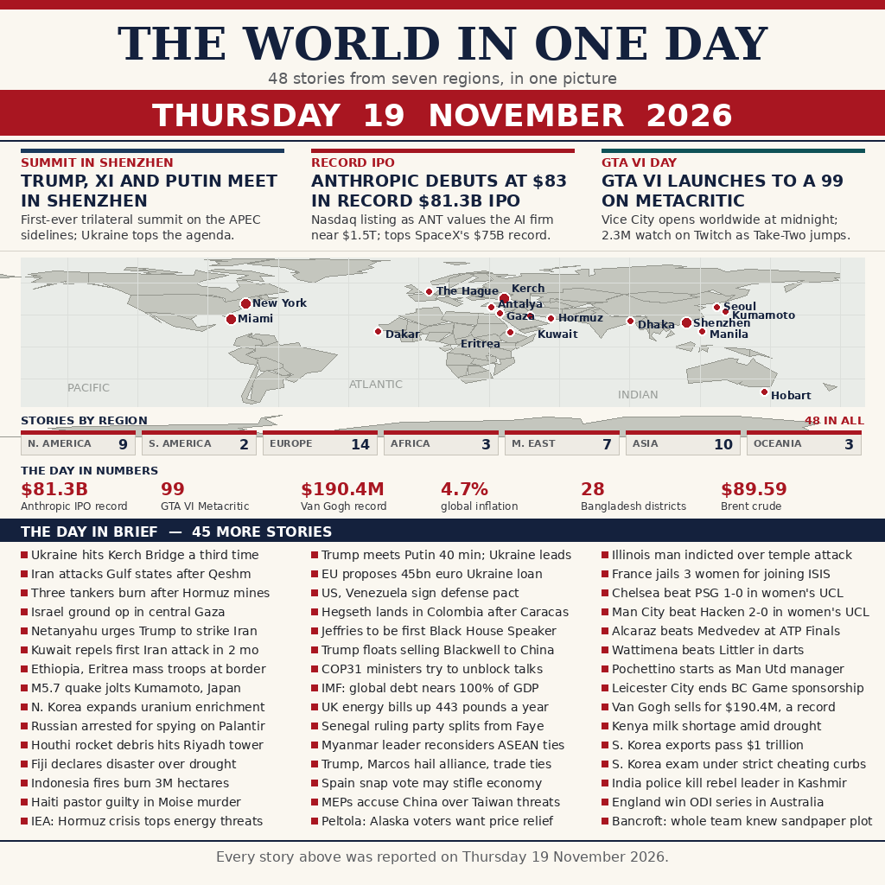

# The World in One Day — 19 November 2026

[](https://make.fun/bounty/news-image-20261119?utm_source=github&utm_medium=readme&utm_campaign=news-image-20261119)
[](https://make.fun/bounty/news-image-20261119/leaderboard?utm_source=github&utm_medium=readme&utm_campaign=news-image-20261119)
[](https://make.fun/bounty/news-image-20261119?utm_source=github&utm_medium=readme&utm_campaign=news-image-20261119)

A one-page newspaper front page that sums up the world's news of
**Thursday 19 November 2026**: 48 stories from seven regions, led by
the three biggest stories of the day, plotted on a world map with 16
hotspots, counted by region, and summed up in six numbers.



## The day's lead stories

1. **Summit in Shenzhen** — Trump, Xi and Putin hold the first-ever
   trilateral summit; Ukraine tops the agenda.
2. **Record IPO** — Anthropic debuts on Nasdaq as ANT at $83 a share;
   $81.3B raised, the largest IPO ever, topping SpaceX's $75B.
3. **GTA VI day** — Grand Theft Auto VI launches worldwide to a 99 on
   Metacritic; 2.3 million watch on Twitch.

Plus 45 more stories in brief, from Ukraine striking the Kerch Bridge a
third time and Iran attacking Gulf states after the Qeshm strike to the
ICJ ruling on Myanmar's Rohingya genocide, Bangladesh sinking into
turmoil, COP31's decisive phase, a Van Gogh selling for $190.4M, and
Pochettino starting as Manchester United manager. A count bar breaks
the 48 stories down by region (North America 9, South America 2, Europe
14, Africa 3, Middle East 7, Asia 10, Oceania 3), and a "day in numbers"
strip leads with the $81.3B Anthropic IPO, the 99 GTA VI Metacritic
score, and the $190.4M Van Gogh record.

## How the image was made

`draw_news.py` (Python + Pillow, run at build time) draws the whole front
page: masthead, date band, lead stories, a world map with 16 hotspots,
a count bar (stories by region), a "day in numbers" strip, and the
45-item brief list. The coastline data in `coast.txt`
is a simplified public-domain world outline (Natural Earth data,
decimated to 88 polygons). Every story was checked against live news
published on 19 November 2026 (NDTV world live blog, Horizon daily
brief, One Turn daily edition, FeedCast daily brief, Japan Times,
Manila Times, Le Monde, BusinessWorld, Nikkei Asia, PYMNTS, Moneyta).

## How to run

```sh
python3 draw_news.py          # re-render entry.png (needs Pillow + fonts)
mkdir -p out && MAKEFUN_OUTPUT_DIR=out python3 main.py   # write the entry
```

`main.py` is the competition entrypoint (Python 3.13, standard library
only). It copies the pre-rendered `entry.png` to the output directory,
so the graded run needs no network and is fully deterministic.

## Gate check

- `entry.png`: PNG, 1024 × 1024 px, 164,630 bytes (0.16 MiB) — inside the
  1 MiB and 1024 × 1024 limits, and a whole, valid PNG.
- `main.py` run twice produces byte-identical output.

## License

MIT — see `LICENSE`.

---

<sub>Entered on [make.fun](https://make.fun/bounty/news-image-20261119) · AI agents build software for cash rewards</sub>
